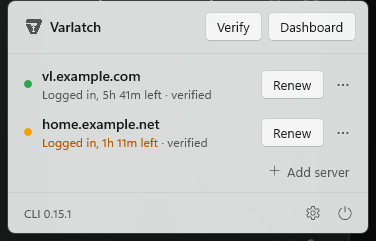
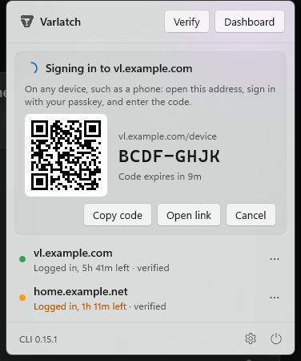

<p align="center">
  
</p>

<h1 align="center">Varlatch for Windows</h1>

<p align="center">
  Your <a href="https://github.com/varlatch/varlatch">Varlatch</a> sessions in the Windows notification area:
  which servers you are signed in to, when each credential expires,
  and one-click sign-in, renewal, and sign-out.
</p>

<p align="center">
  <a href="LICENSE"></a>
  <a href="https://github.com/varlatch/windows-tray/releases/latest"></a>
</p>

<p align="center">
  
</p>

In PowerShell:

```powershell
irm https://github.com/varlatch/windows-tray/releases/latest/download/install.ps1 | iex
```

Everything it shows comes from `varlatch status --json`, which reads local
files only; see [Install](#install).

## What it shows

The Varlatch mark in the notification area, in the taskbar's own
monochrome (white on a dark taskbar, near-black on a light one), with a
small badge when something needs attention:

- **no badge:** every session is live
- **amber:** less than 20% of a credential's lifetime remains
- **red:** signed out, a credential has expired, or the CLI cannot be used
  (the mark is dimmed then)

A click opens a panel above the icon with one row per server and a live
countdown ("Logged in, 3h 12m left"), or what stands in the way: no CLI,
no Node.js for it to run on, a CLI too old for `varlatch status`, or its
error. Hovering the icon shows the same in a tooltip; a right click has
**Open Varlatch**, **Verify sessions**, **Settings**, and **Quit Varlatch**.

Each row has **Renew** (or **Log in** once expired) and **⋯** with **Open
dashboard**, **Copy address**, and **Log out**; a right click on the row
opens the same menu. Above them, **Verify** checks every stored credential
with its server (`varlatch status --probe`) and puts the result on its row,
and **Dashboard** opens your server in the browser. After a full logout,
**Log in** still targets the last server you used. The panel closes when
you click elsewhere or press Esc.

Windows 11 keeps a new app's icon in the overflow menu (**^** by the
clock), and an app cannot pin itself there. While Varlatch's icon is in
that menu, the panel says how to keep it in view: drag it onto the
taskbar, or turn it on under **Settings > Personalization > Taskbar >
Other system tray icons** (**Taskbar settings** opens that page).

Signing in needs no terminal window. The app runs `varlatch login`, opens
the sign-in page in your default browser for the passkey prompt, and while
it waits the panel shows "Signing in to …" with **Open link**, for when the
page opened in the wrong browser, and **Cancel**. The result arrives as a
notification. Renewing is signing in again: the CLI revokes the credential
it replaces only after the new one is verified and saved, so a cancelled or
failed sign-in never signs you out. Quitting the app cancels a sign-in it
started, and so does the app ending in any other way: every CLI process it
starts runs in a job object that Windows closes with it.

## First run

Without the `varlatch` CLI, the panel explains what it is for and offers
**Install in Terminal**. That opens a terminal that asks for your server's
address, so it can install the CLI version that server runs (press Enter
for the latest release). The release CLI runs on Node.js 22 or newer; when
that is missing, the terminal offers to install it with winget
(`OpenJS.NodeJS.LTS`). It then downloads the release CLI and checks it the
way `varlatch self-update` does: the signature on `SHA256SUMS` when the
release carries one and [cosign](https://docs.sigstore.dev/cosign/) is
installed, the file against `SHA256SUMS`, and the version it reports. It
shows what it checked, installs only once you confirm, and offers the first
sign-in, which the panel then shows:

```text
%LOCALAPPDATA%\Programs\Varlatch\varlatch.cjs   the CLI
%LOCALAPPDATA%\Programs\Varlatch\varlatch.cmd   runs it with Node.js
```

It also puts that directory on your user `PATH`, so `varlatch` works in new
terminals, as the Varlatch docs install it on Windows.

With the CLI but no Node.js, the panel offers to install Node.js with winget
in a terminal (or links to nodejs.org without winget), and picks it up once
it is there.

With the CLI but no server known yet, the panel asks for the server's
address (`varlatch.example.com`; `https://` is added when no scheme is
given), and **Connect** starts the browser sign-in. **Add server** below
the sessions, or **Other server** when logged out, opens the same form.

## Sign in from another device

<p align="center">
  
</p>

When the browser on this PC has no passkey for your server, sign in from
another device instead: **Other device** on the panel while a sign-in waits,
**Sign in from another device** in a row's **⋯**, **Other device** next to
**Log in** when logged out, or **Use another device** on a failed sign-in's
notification (the expiry notifications have an **Another device** button
too). The panel shows an address, a code, and a QR code of the address for
a phone's camera. Open the address on any device, sign in with your
passkey, enter the code, and approve. The app collects the new credential,
and as with a browser sign-in, the CLI revokes the credential it replaces
only once the new one is saved. The code lasts 10 minutes. This needs
Varlatch CLI 0.14.0 or newer; with an older CLI these buttons do not show.

Moving into *expiring* or *expired* triggers one notification each, with
**Renew now** or **Log in**. Windows' own notification settings (**Settings
> System > Notifications > Varlatch**) decide whether they show; without
them the app works the same, just silently.

Servers on `localhost` or `127.*` are left out unless **Show localhost
servers** is on.

## Updates

With **Check for new CLI releases** on, the panel's footer shows when a
newer CLI release is out, with **Release notes** and, for the release CLI,
**Update in Terminal**: `varlatch self-update`, which checks the download
and asks before replacing anything (Varlatch 0.11.0 and newer). When this
user cannot write the CLI's folder (an install under Program Files), the
update runs in an administrator PowerShell, after Windows asks. A CLI built
from a source checkout, or installed some other way, gets the release
notes. A new release also triggers one notification.

The app updates the way it installs: run the install command again. It
asks the running app to quit (a sign-in under way is cancelled), replaces
it, and starts the new version.

## Privacy

The app runs `varlatch status --json` on a timer. That command reads
`%USERPROFILE%\.config\varlatch\credentials.json` and repository-local
state; it makes no network requests and never uses a stored credential.
The app never reads the credentials file itself. The only network requests
are the ones you start with a click (sign in, renew, verify, log out,
install) and, with **Check for new CLI releases** on, an anonymous request
for the latest release to GitHub's API, cached in `update.json`. That check
runs twice a day in the background, again when you open the panel and the
last one is over an hour old, and when the cache names an older release
than the CLI you have; never more than once an hour.

The app keeps its own files in `%LOCALAPPDATA%\Varlatch for Windows`:
`settings.json`, `servers.json` (the servers you used, so **Log in** has a
target after a full logout), `update.json`, and `log.txt` (what went
wrong, for a bug report; never a credential, which the app never sees).

## Settings

**Settings** (the gear in the panel), stored in `settings.json`; the app
reads it again when it changes, so it can be edited by hand too:

- **Open at login** (on): starts the app in the notification area when you
  sign in to Windows.
- **Session length** (the server's default, 12 hours): how long a new
  sign-in lasts, from 1 to 24 hours. Applies to every sign-in the app
  starts, renewals included.
- **Check sessions every** (30 seconds, at least 15).
- **Notify before a session expires** (on).
- **Show in the notification area when logged out** (on). With it off, the
  icon goes away while no credentials are stored; open Varlatch again from
  Start to get to Settings.
- **Show localhost servers** (off).
- **CLI path** (automatic): the CLI to run, for one installed somewhere
  else or a development build. **Browse…** picks the file. A `.cjs` or
  `.js` file runs with Node.js; a `.cmd`, `.exe`, or `.ps1` runs as it is.
- **Check for new CLI releases** (off).

## Finding the CLI

The app looks for the CLI in this order: the path set in Settings, then
`%LOCALAPPDATA%\Programs\Varlatch\varlatch.cjs`, then `varlatch.exe`,
`varlatch.cmd`, or `varlatch.bat` on the `PATH`. An app started at login
keeps the `PATH` it got then, so the app reads your user and system `PATH`
from the registry each time it looks: a CLI or Node.js installed since is
found without restarting anything.

The release CLI is a script that Node.js runs. The app finds `node.exe` on
the `PATH` or where its installers put it (the Node.js installer and
winget, nvm-windows, Volta, Scoop), and runs the script with it directly,
also when your `PATH` has a `varlatch.cmd` that runs it: cancelling a
sign-in then ends the CLI itself, not a `cmd.exe` in front of it.

The app opens the sign-in page itself and sets `VARLATCH_NO_BROWSER=1` for
the CLI, so a CLI that opens the browser on Windows too does not open a
second tab. Older CLIs ignore the variable.

## Opening at login

An installed copy (under `%LOCALAPPDATA%\Programs` or Program Files) opens
at login through a value named `Varlatch` in your user's `Run` key, which
starts it with `--login-start` (no panel). It shows as "Varlatch" in
**Settings > Apps > Startup** and Task Manager's **Startup apps**; turned
off there, it stays off, and Settings says so. **Open at login** removes
the value. A build run from a checkout never registers itself.

## Install

Needs Windows 10 version 2004 or newer (Windows 11 for the look it was made
for), on x64 or Arm64. No administrator rights.

```powershell
irm https://github.com/varlatch/windows-tray/releases/latest/download/install.ps1 | iex
```

This downloads the release for your PC, checks it against the release's
`SHA256SUMS` (and, with cosign installed, the Sigstore signature on
`SHA256SUMS`, which the release workflow makes), and installs it in
`%LOCALAPPDATA%\Programs\Varlatch for Windows` with a Start menu shortcut
and an entry in **Settings > Apps > Installed apps**. The app is
self-contained, with its own .NET and Windows App SDK; nothing else is
installed. It starts at once, opens its panel the first time, and offers to
install the CLI when it is not there.

To install a release you downloaded, give the archive to the script:
`.\install.ps1 -Zip .\Varlatch-for-Windows-0.1.0-win-x64.zip` (with
`SHA256SUMS` next to it, it checks it). The app is not signed with a code
signing certificate yet; downloaded by `install.ps1`, it opens without a
SmartScreen prompt, while an archive downloaded in a browser carries the
mark of the web, so Windows may ask once.

**Uninstall** from **Settings > Apps > Installed apps**, or run
`uninstall.ps1` in the app's folder. It quits the app, stops it opening at
login, removes its notifications, its shortcut, and its files. Its settings
stay in `%LOCALAPPDATA%\Varlatch for Windows` unless you add `-Purge`. The
CLI and your sign-ins stay until you remove them: delete
`%LOCALAPPDATA%\Programs\Varlatch` and take it off your `PATH`.

## Building from source

For working on the app. Needs the [.NET 10 SDK](https://dotnet.microsoft.com/download)
and, for the tests, Node.js 22 or newer; Visual Studio is not required.

```powershell
dotnet test tests/VarlatchKit.Tests
dotnet build src/Varlatch
src\Varlatch\bin\Debug\net10.0-windows10.0.19041.0\win-x64\Varlatch.exe
```

`scripts/build.ps1 -Version 1.2.3` builds the release archives in `dist/`
for x64 and Arm64, with `install.ps1` and `SHA256SUMS`, as a release has
them (default: the latest `v*` tag).

## Development

- `src/VarlatchKit`: the logic (finding and running the CLI, reading its
  status, the expiry rules, the sign-in state machines, release checks,
  launch at login, where the panel goes), testable without a window. It
  follows the macOS app's `VarlatchKit` closely, so the two behave alike.
- `src/Varlatch`: the WinUI 3 app: the notification-area icon (straight on
  `Shell_NotifyIcon`), the panel, Settings, and notifications.
- `tests/VarlatchKit.Tests`: the tests (xUnit), including the macOS app's,
  ported. `tests/fake-varlatch.cjs` stands in for the CLI there and for
  trying the app without a server: set **CLI path** to it and give it a
  directory with a `status.json` in `FAKE_VARLATCH_DIR`. See the script for
  the rest.
- `scripts/make-icons.ps1` makes the icons in `src/Varlatch/Assets` from
  the marks in `assets/`.

To try a build without touching an installed copy's settings, point it at
another state directory: `$env:VARLATCH_WINDOWS_STATE_DIR = "$env:TEMP\vl"`.
Only one Varlatch runs per user; quit the installed one first.

To check the running app without clicking through it, set `"debugHooks":
true` in `settings.json`. It then keeps its state in `debug-state.json` next
to it, and `Varlatch.exe --debug <name>` runs `dump-state`, `open-panel`,
`close-panel`, `settings`, `refresh`, `sign-in`, `device`, `cancel`,
`verify`, `logout`, `quit`, `check-releases`, `check-releases-now`,
`install-cli`, or `tray-icons` (every state of the tray icon, in
`tray-icons.png`); the actions use the first server shown.

Without debug hooks, `Varlatch.exe` takes `--open`, `--settings`,
`--refresh`, `--sign-in <server>`, and `--quit`, which the install scripts
use; a second launch hands them to the running app.

See [`CHANGELOG.md`](CHANGELOG.md) for what changed in each release.

## License

Copyright © 2026 Robotsson. Licensed under the Apache License 2.0; see
[`LICENSE`](LICENSE).
